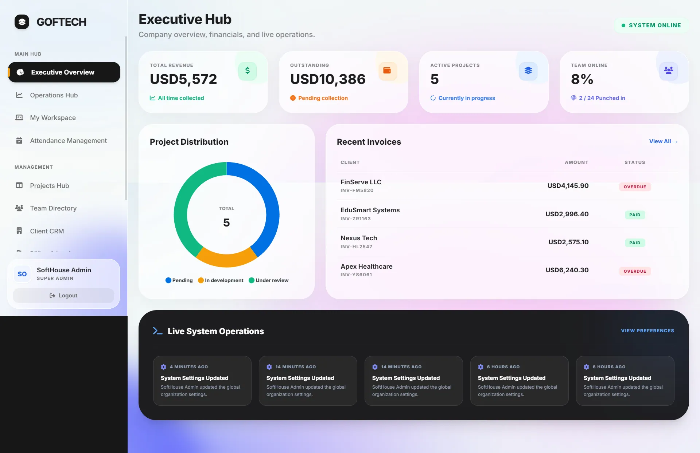
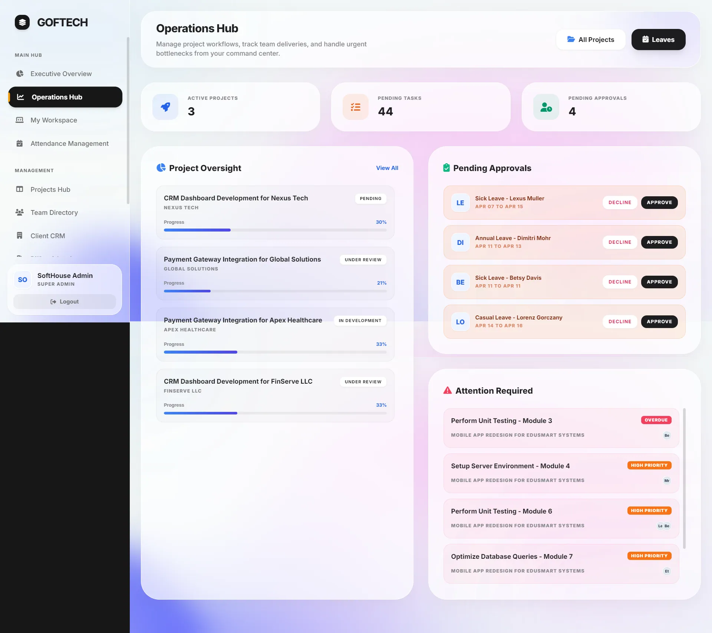
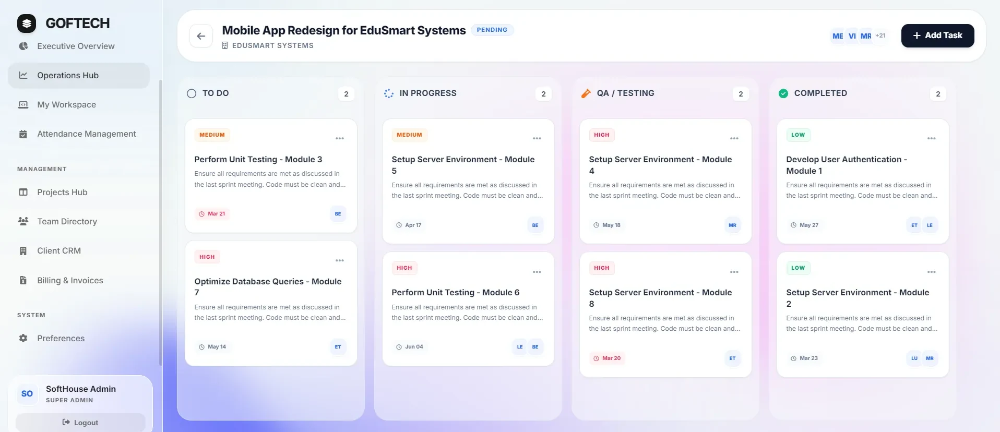
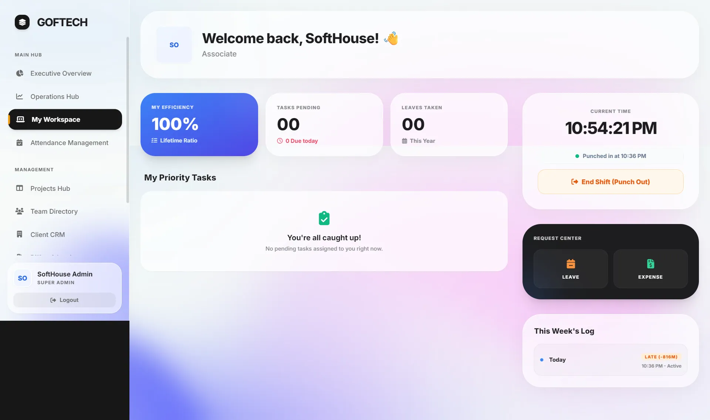
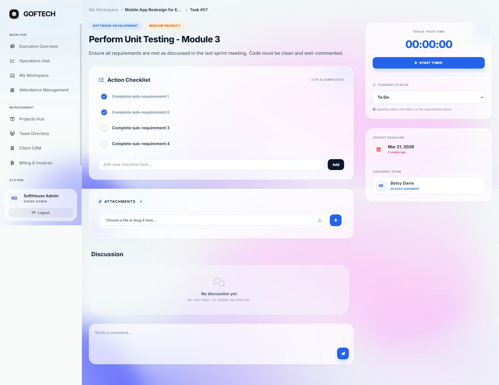
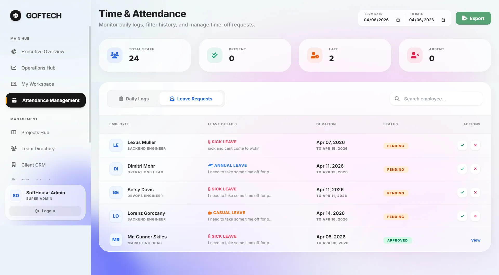
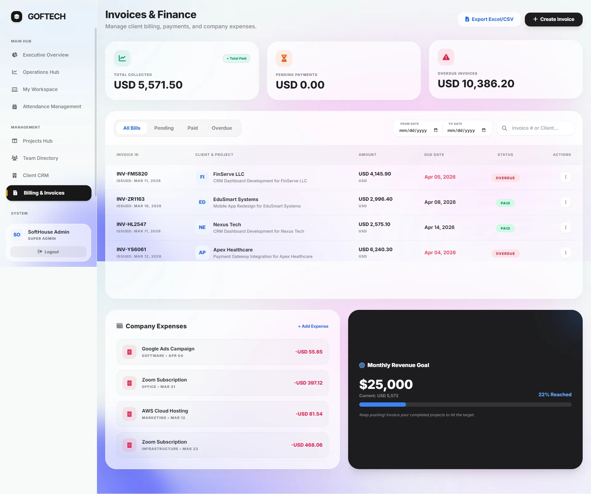

# SoftHouse Pro ERP

A Laravel ERP that gives software houses one place for projects, attendance, performance scoring, invoicing and a client portal.

**Case study:** [farhadnazir.com/projects/software-house-erp](https://farhadnazir.com/projects/software-house-erp/)

The Executive Hub: the owner's view of revenue, projects and team activity.

> [!NOTE]
> This repository is a **project showcase**. The source code is private (client project), so there is no code or setup guide here. Screenshots show seeded demo data.

## About

SoftHouse Pro is a web-based ERP built for a software house. It brings project management, HR, attendance, time tracking, client management and billing into one Laravel application, instead of a set of separate tools.

The app has four roles, each with its own portal:

| Portal | Role | What it is for |
|---|---|---|
| Executive Hub | Super admin (owner) | Revenue, outstanding invoices, project distribution and a live operations log |
| Operations Hub | Manager | Project progress, Kanban boards, leave approvals and overdue work |
| Workspace | Associate (developers, designers, QA) | Punch in and out, breaks, tasks, time tracking and leave requests |
| Client Portal | Client | Progress of their own projects and their own invoices |

I was the sole developer. I designed it as static HTML prototypes first, then built the Laravel app, deployed it for the agency and wrote the user manual it was handed over with. It was delivered through [Techwine Solutions](https://www.techwinesolutions.com).

## Key features

### Attendance and HR

- **Punch-in, punch-out and break tracking.** Each punch-in is marked present or late against the office start time plus a grace period. Breaks are logged separately and totalled per day.
- **Office IP restriction and proxy prevention.** Office-based staff can only punch in from whitelisted office IP addresses, while remote employees skip that check. A per-day device cookie stops a second employee from punching in on the same browser.
- **Automated late-arrival emails.** A scheduled command runs every minute and, once the start time plus grace period has passed, emails associates and managers who have not punched in. Employees who punch in late get an email straight away.
- **Leave management.** Staff request sick, casual or annual leave and managers approve or decline in one click. Daily attendance logs can be filtered by date and exported to CSV.
- **Employee performance score.** Each profile shows task completion, attendance reliability and an overall score weighted 60% on tasks and 40% on attendance, with filters for 7 days, 30 days, last month and 3 months.

### Projects and tasks

- **Kanban board with undo.** Tasks move between To Do, In Progress, QA/Testing and Completed by drag and drop. Every move updates the project's progress percentage, and the last move can be undone.
- **Task detail with live timer.** Each task has a checklist, discussion comments, file attachments and a start/stop timer that records time logs and shows a running clock.

### Clients and billing

- **Client CRM and invoice builder.** Clients carry their own currency, tax rate and payment terms. Invoices fill in tax and due date from those settings, can be marked paid or exported to CSV, and download as PDF.
- **Secure client portal.** Clients see the progress of their own projects and download their own invoices. Ownership is checked on the server for every project page and PDF download.

### Access control

- **Four role-based portals.** Super admin, manager, associate and client roles are enforced by custom middleware, and each role lands on its own dashboard after login.

## Screenshots

| | |
|:---:|:---:|
|  |  |
| Operations Hub: leave approvals and overdue work. | Kanban board: moving a card updates task status and project progress. |
|  |  |
| Associate Workspace: punch in and out, with late arrivals logged. | Task detail: checklist, attachments, comments and time tracker. |
|  |  |
| Attendance logs and leave requests in one place. | Invoices, expenses and a monthly revenue goal. |

## Tech stack

| Area | Technology |
|---|---|
| Backend | Laravel 12, PHP |
| Front end | Livewire 3, Alpine.js, Blade, Tailwind CSS, Vite |
| Database | MySQL |
| Auth | Laravel Breeze with a role field and custom role middleware |
| Charts | ApexCharts |
| Documents | DomPDF (invoice PDFs), CSV exports |
| Notifications | Laravel scheduler and Laravel Mail |

## Architecture

SoftHouse Pro is a server-rendered Laravel monolith on the TALL stack. Each module is a full-page Livewire 3 component (22 in total), with Alpine.js handling client-side interactions such as drag and drop and the live task timer. The data layer has 20 Eloquent models over a MySQL schema built from 28 migrations. Multi-table writes run inside database transactions.

- **Role-based access and ownership checks.** Route groups are gated by a custom middleware that accepts several roles. Server-side checks limit associates to their own profile and clients to their own projects and invoices.
- **Attendance anti-fraud.** An office IP whitelist from organization settings, a per-day device cookie and a per-employee remote-work bypass keep attendance fair without blocking remote staff.
- **Explainable performance formula.** A deterministic weighted score: 60% task completion and 40% attendance reliability, with partial credit for late (0.8) and half-day (0.5) records, and fallbacks when one side has no data.
- **Scheduler-driven notifications.** A scheduled command runs every minute and sends late-arrival emails, keyed to the configurable office start time and grace period.
- **Billing from client settings.** Due dates come from each client's payment terms (for example Net 15) and tax from their billing settings.
- **Reusable attachments and shared settings.** File attachments use a polymorphic relation shared through a trait. Organization settings are shared with every view, guarded so the app can still boot before migrations have run.

## Links

- Case study: [farhadnazir.com/projects/software-house-erp](https://farhadnazir.com/projects/software-house-erp/)
- More projects: [farhadnazir.com/projects](https://farhadnazir.com/projects/)

## Author

**Farhad Nazir**, full-stack software developer and founder of [Techwine Solutions](https://www.techwinesolutions.com)

- Website: [farhadnazir.com](https://farhadnazir.com)
- Email: [farhadnazirksa@gmail.com](mailto:farhadnazirksa@gmail.com)
- LinkedIn: [linkedin.com/in/farhadnazir](https://www.linkedin.com/in/farhadnazir)
- WhatsApp: [+966 53 656 6380](https://wa.me/966536566380)

Interested in a system like this for your company? [Get in touch](https://farhadnazir.com/contact/).

Also by me: [Asaan Optics](https://github.com/farhadnazir/Asaan-Optics-App-Official), POS and shop management software for optical shops.

## License

Proprietary. This repository contains documentation and screenshots only.
